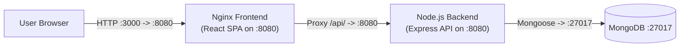
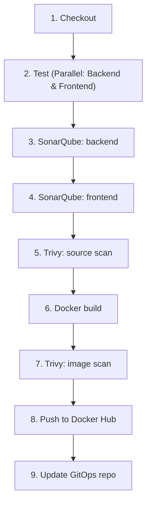

# ShopKart

ShopKart is a 3-tier product catalogue application featuring a React and Vite frontend served by a non-root Nginx container, a Node.js and Express backend REST API, and a MongoDB database. The codebase is tested, quality-gated, and security-scanned by Jenkins, with container images pushed to Docker Hub and automatically deployed to an Amazon EKS cluster via Argo CD GitOps synchronization.

---

## ShopKart Project Map

The ShopKart DevOps platform is split across three Git repositories:

| Repository | What it holds | Location |
| :--- | :--- | :--- |
| **[shopkart-app](https://github.com/vkashsingh/shopkart-app)** | Application source code, Dockerfiles, local Docker Compose setup, Jenkinsfile CI pipeline, and architecture documentation. | **You are here: shopkart-app** |
| **[shopkart-infra](https://github.com/vkashsingh/shopkart-infra)** | Terraform code for AWS infrastructure (Jenkins CI/CD master EC2 instance and Amazon EKS cluster). | [shopkart-infra](https://github.com/vkashsingh/shopkart-infra) |
| **[shopkart-gitops](https://github.com/vkashsingh/shopkart-gitops)** | Kubernetes deployment manifests and Argo CD Application definitions. | [shopkart-gitops](https://github.com/vkashsingh/shopkart-gitops) |

---

## Architecture

The runtime traffic flow between components:



- **Frontend:** React 19 single-page application built with Vite and served by `nginx-unprivileged:1.30-alpine` (UID 101) on port 8080.
- **Backend:** Node.js 24 and Express 5 application running as non-root user `node` on port 8080.
- **Database:** MongoDB 8.0 storing product catalogue collections.

---

## Repository Structure

```text
.
├── Jenkinsfile                  # Jenkins declarative CI pipeline definition
├── README.md                    # Project overview and runbook
├── docker-compose.yml           # Local multi-container development environment
├── backend/                     # Backend API service
│   ├── .dockerignore            # Docker build ignore rules
│   ├── .env.example             # Template for local environment variables
│   ├── Dockerfile               # Multi-stage Dockerfile (node:24-alpine, user node)
│   ├── eslint.config.js         # ESLint flat config
│   ├── package.json             # Node dependencies and test scripts
│   ├── package-lock.json        # Pinned dependency lockfile
│   ├── sonar-project.properties # SonarQube scanner properties
│   ├── src/                     # Backend source files
│   │   ├── app.js               # Express application and route registrations
│   │   ├── metrics.js           # Prometheus metrics and HTTP logging middleware
│   │   ├── models/product.js    # Mongoose Product model schema
│   │   ├── routes/products.js   # Product CRUD endpoints
│   │   └── server.js            # HTTP listener, Mongo connection, graceful shutdown
│   └── tests/products.test.js   # Offline Jest tests with mocked Mongoose model
├── frontend/                    # Frontend React SPA
│   ├── .dockerignore            # Docker build ignore rules
│   ├── Dockerfile               # Multi-stage Dockerfile (Vite build -> unprivileged Nginx)
│   ├── eslint.config.js         # ESLint flat config
│   ├── index.html               # SPA entrypoint HTML
│   ├── nginx.conf               # Nginx reverse proxy and SPA fallback routing
│   ├── package.json             # React dependencies and scripts
│   ├── package-lock.json        # Pinned dependency lockfile
│   ├── sonar-project.properties # SonarQube scanner properties
│   ├── src/                     # Frontend source files
│   │   ├── App.jsx              # Product catalogue view and management forms
│   │   ├── App.test.jsx         # Vitest and React Testing Library tests
│   │   ├── index.css            # Stylesheet (plain CSS)
│   │   ├── main.jsx             # React entrypoint
│   │   └── setupTests.js        # Test environment setup
│   └── vite.config.js           # Vite dev server and proxy configuration
└── docs/                        # Architecture documentation
    └── architecture.md          # End-to-end architecture and pipeline guide
```

---

## Run Locally

Start all three services using Docker Compose:

```bash
docker compose up -d --build
```

Access the application in your browser at: **[http://localhost:3000](http://localhost:3000)**.

### Ports Table

| Service | Container Port | Host Port | Purpose |
| :--- | :--- | :--- | :--- |
| `shop-frontend` | `8080` | `3000` | Nginx reverse proxy and static asset server. |
| `shop-backend` | `8080` | None (Internal) | Express REST API server. |
| `mongo` | `27017` | None (Internal) | MongoDB database. |

### Environment Variables

| Variable | Default | Service | Description |
| :--- | :--- | :--- | :--- |
| `PORT` | `8080` | `shop-backend` | Port on which Express listens. |
| `MONGO_URL` | `mongodb://mongo:27017/shopkart` | `shop-backend` | MongoDB connection URL. |

To stop the containers:

```bash
docker compose down
```

---

## Tests

Both backend and frontend test suites run offline without requiring external network access or running databases.

### Backend Tests

Runs Jest test suites with mocked Mongoose models and outputs coverage to `backend/coverage/lcov.info`:

```bash
cd backend
npm install
npm test
npm run lint
```

### Frontend Tests

Runs Vitest and React Testing Library tests with mocked `fetch` calls and outputs coverage to `frontend/coverage/lcov.info`:

```bash
cd frontend
npm install
npm test
npm run lint
```

---

## API and Health Endpoints

| Endpoint | Method | Response | Used By | Purpose |
| :--- | :--- | :--- | :--- | :--- |
| `/api/products` | `GET`, `POST` | `200`, `201`, `400` | Frontend UI | Retrieve product list or create a product. |
| `/api/products/:id` | `GET`, `PUT`, `DELETE` | `200`, `204`, `400`, `404` | Frontend UI | Fetch, update, or remove a product by ID. |
| `/health` | `GET` | `200 {"status":"ok"}` | Docker healthcheck / K8s liveness probe | Liveness verification (no DB check). |
| `/ready` | `GET` | `200` or `503` | K8s readiness probe | Readiness check (verifies Mongo connection state). |
| `/metrics` | `GET` | `200` (Prometheus text) | Prometheus scraper | Exposes Node metrics, request counts, and durations. |
| `/nginx-health` | `GET` | `200 "healthy\n"` | Docker healthcheck / Frontend probe | Nginx server availability check. |

---

## CI Pipeline

The continuous integration pipeline is defined in [Jenkinsfile](Jenkinsfile).

### Pipeline Flowchart



### Pipeline Details

- **Trigger:** Configured with `pollSCM('H/2 * * * *')` to poll Git every 2 minutes.
- **Image Tagging:** Uses the 7-character Git SHA (`git rev-parse --short=7 HEAD`) as the immutable tag for both images.
- **Container Images:** `vkashs/shopkart-backend` and `vkashs/shopkart-frontend`.
- **Jenkins Credentials:**
  - `dockerhub`: Docker Hub username and access token for container registry authentication.
  - `github-token`: GitHub personal access token used to clone and update the GitOps repository.

### Stages Summary

| Stage | What it does |
| :--- | :--- |
| **Checkout** | Clones the commit and extracts the 7-character Git SHA (`GIT_SHA`). |
| **Test** | Runs backend and frontend unit tests in parallel with `npm ci && npm test`. |
| **SonarQube: backend** | Runs `sonar-scanner` against backend code and blocks on the Quality Gate result. |
| **SonarQube: frontend** | Runs `sonar-scanner` against frontend code and blocks on the Quality Gate result. |
| **Trivy: source scan** | Runs `trivy fs` on repository files, failing on CRITICAL vulnerabilities or secret leaks. |
| **Docker build** | Builds both container images using `docker build --pull` tagged with `${GIT_SHA}`. |
| **Trivy: image scan** | Runs `trivy image` against both built images, failing on fixable CRITICAL CVEs. |
| **Push to Docker Hub** | Logs in with `DOCKERHUB_CREDS` and pushes backend and frontend images to Docker Hub. |
| **Update GitOps repo** | Clones `shopkart-gitops` with `GITHUB_CREDS`, updates deployment YAMLs with the new tag, and commits. |

---

## How Deployment Happens

1. The Jenkins CI pipeline builds and validates the artifacts, tags them with the 7-character Git commit SHA, and pushes images to Docker Hub.
2. In the final stage, Jenkins clones [shopkart-gitops](https://github.com/vkashsingh/shopkart-gitops), updates `manifests/backend-deployment.yaml` and `manifests/frontend-deployment.yaml` with the new image tag, and pushes the change to GitHub.
3. Argo CD monitors the `shopkart-gitops` repository. Upon detecting the Git commit, Argo CD automatically reconciles and syncs the new deployment manifests into the Amazon EKS cluster.
4. Kubernetes performs zero-downtime rolling updates for frontend and backend pods.

---

## Architecture Documentation

For in-depth explanations of AWS infrastructure, security hardening, Jenkins configurations, and troubleshooting records, see [docs/architecture.md](docs/architecture.md).
