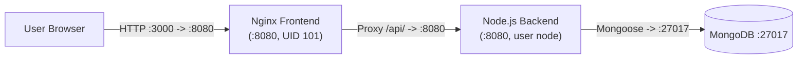
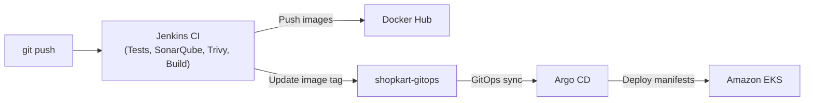

# ShopKart

ShopKart is a 3-tier product catalogue application with a React single-page frontend on unprivileged Nginx, an Express backend running on Node.js 24, and MongoDB. This repository holds the application source code, Dockerfiles, and the Jenkins CI pipeline. Container images are built and scanned automatically, then deployed to Amazon EKS using Argo CD.

## ShopKart Project Map

| Repository | Description | Location |
| :--- | :--- | :--- |
| [shopkart-app](https://github.com/vkashsingh/shopkart-app) | Application source code, Dockerfiles, Docker Compose, Jenkinsfile. | You are here: shopkart-app |
| [shopkart-infra](https://github.com/vkashsingh/shopkart-infra) | Terraform configuration for the Jenkins master EC2 instance and Amazon EKS. | [shopkart-infra](https://github.com/vkashsingh/shopkart-infra) |
| [shopkart-gitops](https://github.com/vkashsingh/shopkart-gitops) | Plain Kubernetes YAML manifests and Argo CD Application resources. | [shopkart-gitops](https://github.com/vkashsingh/shopkart-gitops) |

## App Architecture



Traffic enters through an unprivileged Nginx web server on port 8080 serving the static React build. Nginx proxies all `/api/` requests to the Express backend on port 8080, which connects to MongoDB on port 27017. The backend exposes Prometheus metrics at `/metrics`, which Prometheus scrapes in the EKS cluster.

## CI/CD Flow



Jenkins runs unit tests, SonarQube quality gates, Trivy security scans, and builds container images tagged with the Git commit SHA. Images are pushed to Docker Hub, and Jenkins updates `shopkart-gitops` so Argo CD can deploy the new release to Amazon EKS.

## What's Inside

```text
.
├── Jenkinsfile        # CI pipeline (test, scan, build, push, update GitOps)
├── docker-compose.yml # Local multi-container development setup
├── backend/           # Node.js/Express REST API and Mongoose model
└── frontend/          # React SPA served by unprivileged Nginx
```

## Run Locally

Start all services locally with Docker Compose:

```bash
docker compose up -d --build
```

Open **http://localhost:3000** in your browser. Port 3000 forwards to Nginx on port 8080, which proxies `/api/` calls to the backend.
