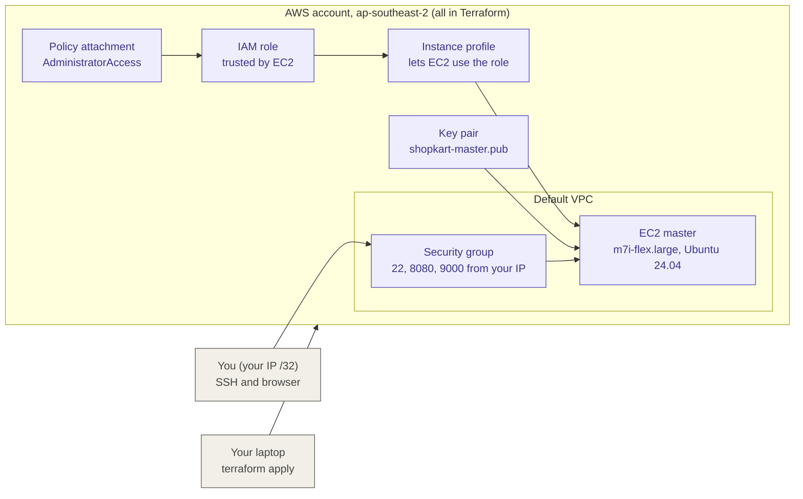
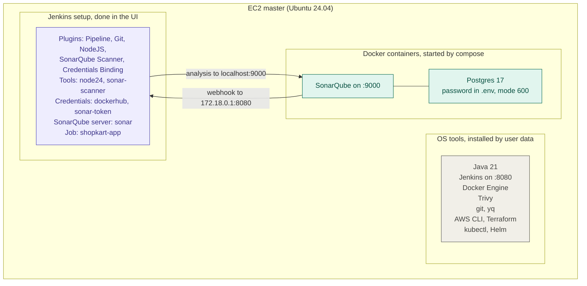
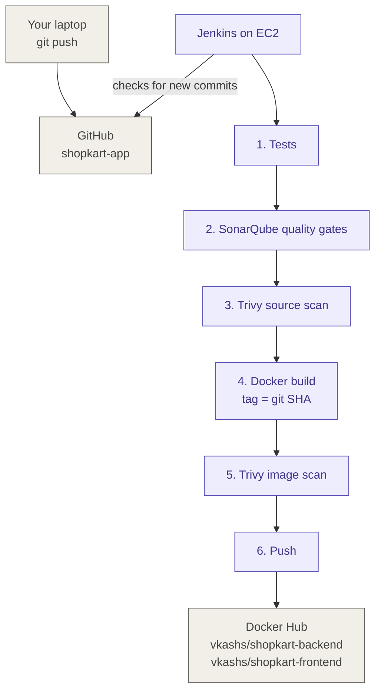

# ShopKart: architecture and CI pipeline

How the ShopKart DevOps demo is built, from the AWS resources to every step of the Jenkins pipeline.

| Repo | What it holds |
|---|---|
| [shopkart-app](https://github.com/vkashsingh/shopkart-app) | App code (React, Node.js), Dockerfiles, docker compose, Jenkinsfile, this document |
| [shopkart-infra](https://github.com/vkashsingh/shopkart-infra) | Terraform for the Jenkins master EC2 (and EKS, later) |
| [shopkart-gitops](https://github.com/vkashsingh/shopkart-gitops) | Kubernetes YAML and the Argo CD Application (coming in Stage 5) |

**Region:** `ap-southeast-2` (Sydney), the region assigned to the AWS project.

---

## 1. AWS resources created by Terraform

Everything inside the AWS box is written in Terraform (`shopkart-infra/infra-master`) and created from the laptop with `terraform apply`.

| Resource | What it does | Why it matters |
|---|---|---|
| IAM role | An identity that EC2 is allowed to assume | No access keys are stored on the server |
| Policy attachment | Gives the role `AdministratorAccess` | Lets Terraform on the master create EKS later. Production would use a scoped policy |
| Instance profile | The "holder" that attaches the role to an EC2 instance | EC2 can't use a role directly, only through a profile |
| Key pair | Uploads your **public** key | You SSH in with the private key that never leaves your laptop |
| Security group | Allows SSH 22, Jenkins 8080 and SonarQube 9000 **from your IP only** | Nothing is open to the internet |
| EC2 master | `m7i-flex.large` (2 vCPU, 8 GB), 30 GB encrypted gp3, IMDSv2 required | Free plan eligible, with enough memory for Jenkins and SonarQube |

**Proof the role works:** on the master, `aws sts get-caller-identity` returns `assumed-role/shopkart-master-role/<instance-id>`.

---

## 2. What runs inside the EC2 master

**The rule:** the machine does the work, and a plugin only teaches Jenkins how to talk to it.

| Layer | Examples | Role |
|---|---|---|
| Installed on the EC2 | Docker Engine, Trivy, git, Java | The real programs. The pipeline calls them with `sh` |
| Jenkins plugins | Pipeline, Git, SonarQube Scanner, Credentials Binding | Jenkinsfile syntax, UI and secret masking. They do no building themselves |
| Jenkins tools | `node24`, `sonar-scanner` | Downloaded by Jenkins into `/var/lib/jenkins/tools` on the first build |

**Why the webhook uses `172.18.0.1`:** SonarQube runs in a container, where `localhost` means the container itself. The Docker network gateway IP is how a container reaches Jenkins on the host.

---

## 3. CI pipeline on every git push

**Jenkins pulls from GitHub; GitHub never pushes to Jenkins.** Today Jenkins checks the repo every 2 minutes (`pollSCM`), because the security group allows only my IP and GitHub can't reach Jenkins. A GitHub webhook is planned (see Next steps).

**Any failed gate stops the build, so an unsafe image is never pushed.**

### What each stage does

| # | Stage | What happens | Example of what it catches |
|---|---|---|---|
| 0 | Checkout | Clones the exact commit. The 7-character git SHA becomes the image tag | Tag `28df35c` always points to one commit, never `latest` |
| 1 | Tests | `npm ci` and `npm test` for backend and frontend, **in parallel**. Coverage goes to `coverage/lcov.info` | A broken API route or React component fails the build early |
| 2 | SonarQube | `sonar-scanner` sends code and coverage to SonarQube. `waitForQualityGate` waits for the webhook result, once per project | New bugs, code smells or security hotspots in **our own code** |
| 3 | Trivy source scan | `trivy fs` scans the repo **before** building: dependencies from `package-lock.json`, hard-coded secrets, Dockerfile misconfigurations. Fails on CRITICAL | An npm package version with a known CVE, an AWS key pasted into a config file, or a Dockerfile that runs as root |
| 4 | Docker build | `docker build --pull` builds both images. `--pull` always fetches the newest base layers instead of a stale cache | Stops old, already-patched CVEs coming back from a cached base image |
| 5 | Trivy image scan | `trivy image` scans the **built image**: base OS packages plus libraries. Fails only on CRITICAL CVEs that have a fix (`--ignore-unfixed`) | Real case: the nginx base had OpenSSL (`libssl3` 3.3.3) and `brotli-libs` CRITICAL CVEs. The source scan **passed**, because those packages come from the base image, not our code |
| 6 | Push | Logs in to Docker Hub with a read/write token, in a per-build `DOCKER_CONFIG`, pushes both images, then logs out | The token is masked as `****` in logs and never written into Git |
| post | Cleanup | Archives the Trivy reports, removes the built images, deletes the workspace | Keeps the master's disk from filling up |

**Why scan twice?** The source scan sees what we **write and import**. The image scan sees what we **ship**, including the OS packages the base image adds.

---

## 4. Security choices

- **No long-lived AWS keys:** the EC2 uses an IAM instance role. IMDSv2 is required.
- **Least exposure:** the security group allows only `/32` (one IP) on 22, 8080 and 9000.
- **Secrets stay in Jenkins credentials** (`dockerhub`, `sonar-token`). The pipeline uses single-quoted `sh` blocks so Groovy never embeds a secret.
- **Non-root containers:** the backend runs as `node`, and the frontend as numeric UID `101` (needed for Kubernetes `runAsNonRoot`).
- **Never committed:** `terraform.tfvars`, `*.tfstate`, saved plan files (`tfplan`), `.env`. gitleaks ran before the first push.
- **Pinned versions:** SonarQube Community Build, Postgres 17, nginx `1.30-alpine`, Node 24.

---

## 5. Problems hit and how they were solved

| Symptom | Root cause | Fix |
|---|---|---|
| 404 on port 8080 locally | A `kubectl port-forward` held the port | Found with `lsof -iTCP:8080`. Ran the backend on 8081 |
| AccessDenied on every AWS call | A service control policy allows only the project region | Moved everything to `ap-southeast-2` |
| `t3.large` rejected | The Free plan allows only free-tier-eligible types. Dry-run checks IAM only | Switched to `m7i-flex.large` (8 GB) |
| Bootstrap stopped with a TLS error | Helm's old apt domain was decommissioned and re-registered by someone else | Moved to Helm's official repo. `set -e` had stopped the script safely |
| Image scan: OpenSSL CRITICAL | An old nginx base image | nginx `1.30-alpine` plus `docker build --pull` |
| Image scan: brotli CRITICAL | The base image lagged behind an Alpine fix | `apk upgrade --no-cache` in the runtime stage, then back to `USER 101` |
| Push: `insufficient scopes` | The Docker Hub token was read-only | New read/write token, updated in place in Jenkins |

---

## 6. Next steps

- **GitHub webhook** instead of polling: allow GitHub's webhook IP ranges in the security group.
- **Email notifications** from Jenkins on success and failure.
- **Stage 4:** EKS with Terraform.
- **Stage 5:** the `shopkart-gitops` repo, plain Kubernetes YAML, and Argo CD.
- **Stage 6:** Prometheus and Grafana.
